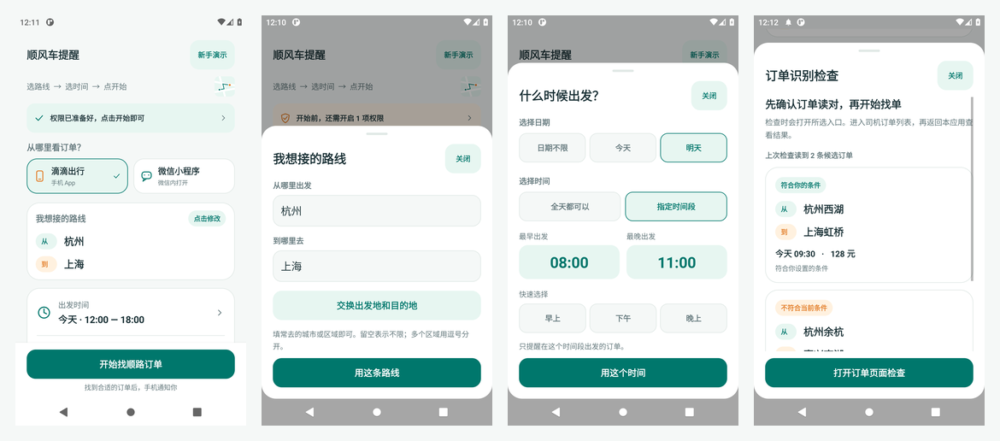
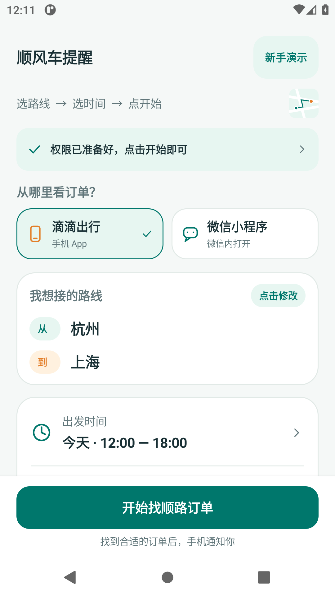
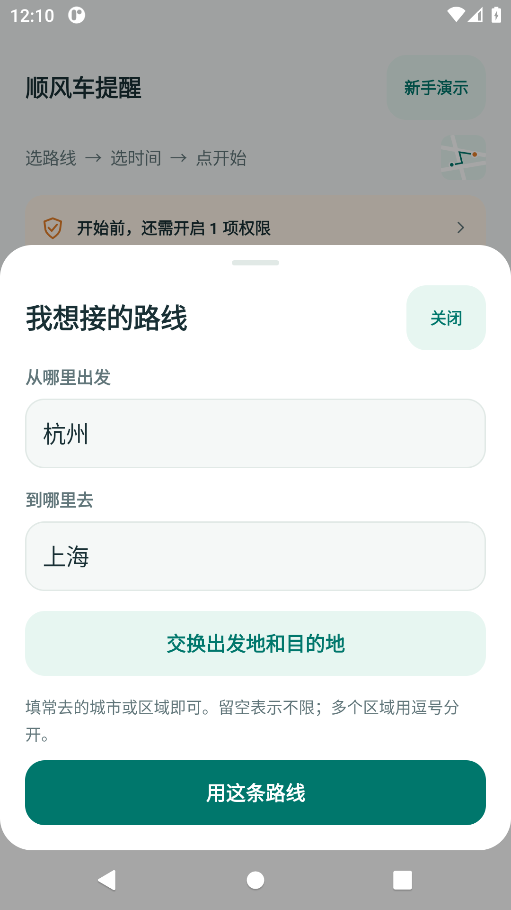
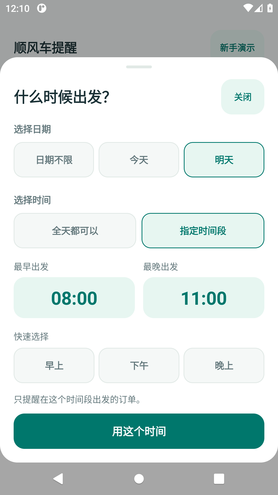
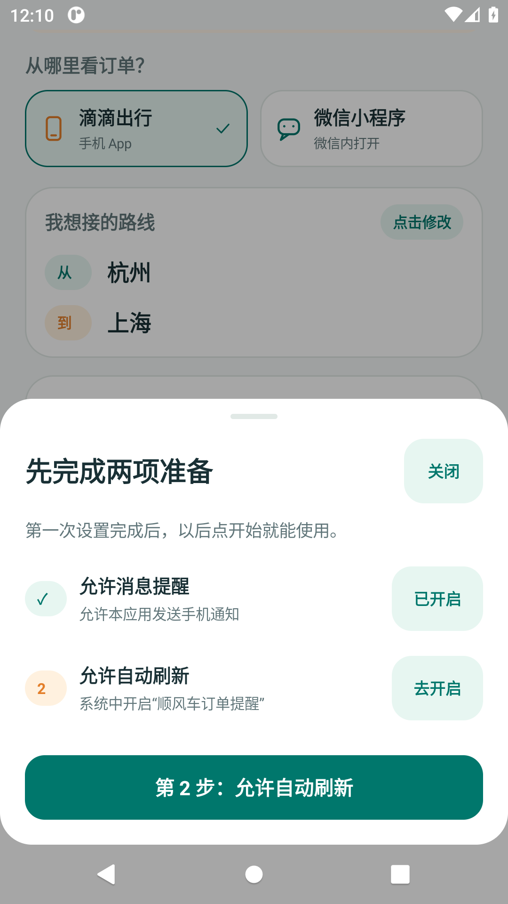
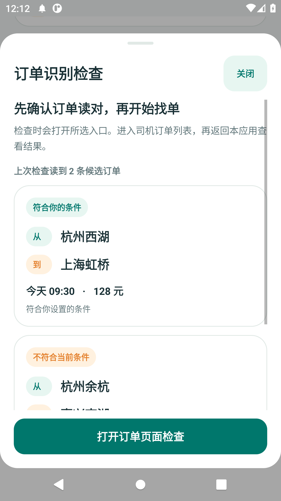
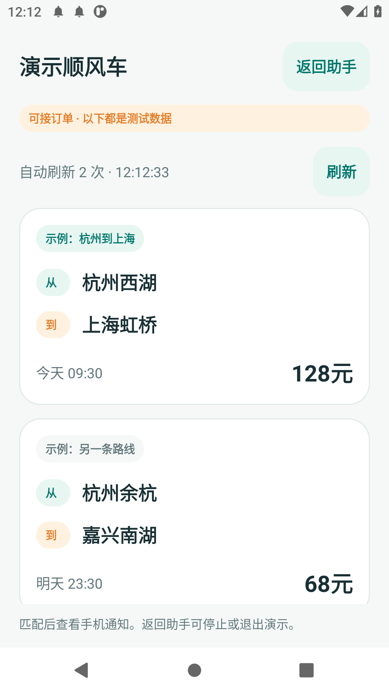

# 顺风车订单提醒

适合司机使用的 Android 辅助 App。选好想接的路线和时间，停留在顺风车订单列表，匹配后用手机通知你。无需 Root。

**[下载安卓 APK](dist/ridewatch-debug.apk)** · [完整源码包](dist/ridewatch-source.zip) · [验证记录](VALIDATION.md)

## 0.2 新手界面

首页只需要“选路线 → 选时间 → 开始”。条件自动保存，首次使用会引导开启权限；开始和停止按钮固定在底部。



<p>
  
  
  
</p>

识别结果显示为订单卡片，起终点、时间、金额和不匹配原因都能直接看到。没有起终点标签时，可以点选文字指定地址。技术设置收进“更多设置”。

<p>
  
  
  
</p>

截图来自 Android 模拟器上的实际界面；其中的订单是演示数据。

[查看实际通知和停止按钮](docs/screenshots/running.png) · [查看小屏幕、放大字体下的时间界面](docs/screenshots/small-time.png)

## 第一次使用

1. 下载 APK，复制到手机并安装。已有 0.1 版可以直接覆盖安装，保留已保存的筛选条件。支持 Android 8.0 及以上。
2. 打开应用，选择“滴滴出行”或“微信小程序”。点“我想接的路线”填出发地和目的地；点“出发时间”选日期和时间段。金额可保持不限。
3. 点底部“开始找顺路订单”。首次使用按提示允许消息提醒，并在系统设置中开启“顺风车订单提醒”的无障碍服务。
4. 按引导进入顺风车的司机 / 车主订单列表，让手机保持亮屏、解锁，并停留在列表顶部。
5. 有匹配订单时收到手机通知。点击通知可以打开所选应用，订单由你自行查看和接单。在应用或运行通知里随时停止。

**先点“新手演示”试一次。**不用登录滴滴，演示会填好“杭州 → 上海，今天 08:00–11:00，至少 100 元”的条件。体验通知和刷新后，点“退出演示”，原有入口、路线、时间和金额会恢复。

首次使用真实滴滴页面时，建议先点“识别检查”：打开实际司机列表后返回查看，核对每条订单的起终点、时间和金额。

## 筛选如何判断

- **路线：**按城市或区域关键词匹配，例如 `西湖`、`虹桥`。多个区域用中文或英文逗号分隔，任选其一。字段留空表示不限该方向的地址。两个不同订单不会合起来匹配。
- **时间：**点选日期“不限 / 今天 / 明天”，再选“全天 / 指定时间段”。支持时间选择器和早上、下午、晚上的快捷选择。
- **跨午夜：**`22:00–02:00` 匹配所选日期的凌晨或夜间。日期和钟点分别判断，不自动扩展为从今晚到明晨的连续日期区间，界面会提示这一点。
- **日期：**支持今天、明天、后天、明确年月日等。选“今天 / 明天”时，日期未读到的订单会跳过。
- **金额：**按页面显示的金额筛选。0 或“不限”表示没有最低金额要求。
- **去重：**同一行程 30 分钟内只提醒一次；重新开始开启新的提醒会话。没有稳定订单 ID 时，同路线、同日期、同时间、同价格的不同订单可能合并为一次提醒。

微信通知会打开微信，需自行进入小程序；不保证直接跳到某条订单。滴滴通知也只打开应用。

## 识别检查

1. 点“识别检查”，再点“打开订单页面检查”，在 2 分钟内进入司机订单列表。
2. 返回本应用，再打开识别检查，查看每条订单卡片。界面显示符合条件、日期不符、金额过低等原因。
3. 若订单没有明确起终点标签，点“点选上车和下车地点”，分别选对应地址，确认后重新检查多条订单的位置是否一致。
4. 若没有完整订单，点“查看读取的文字”。实际列表标题与默认“顺风车”不同，可以在“更多设置 → 调整订单页标题”中修改。

## 运行和适配范围

默认每 30 秒刷新。“更多设置”可选择 15、30 或 60 秒。修改筛选或刷新条件时会停止当前找单，重新点击开始即可使用新设置。

只读取当前可见订单，不自动遍历整张列表。只有目标应用在前台、订单页标题存在、并检测到订单或列表标识时才尝试点击“刷新”或下拉；锁屏、离开列表或进入确认 / 付款页面时暂停。下拉手势提交成功不等于服务器返回新订单。

解析基于无障碍文字和卡片分组。需要两个地址、一个金额和一个出发钟点；多个金额、多个钟点或复杂时间区间会跳过。支持起终点标签、文字箭头和点选地址。纯图片 / Canvas 页面若不提供文字，本版本无法识别，也不含 OCR。

真实滴滴 App / 微信小程序的不同版本可能需要单独适配。**Android 模拟器上的界面和演示验证不能代替真实滴滴兼容性测试。**系统重新连接无障碍服务后，需要手动开始。

预览、条件和上次匹配记录只保存在手机本机。应用没有网络权限。“更多设置 → 清除已读取的订单记录”可以删除预览和摘要。

## 常见问题

- **无障碍开关受限：**部分 Android 13+ 系统对从文件安装的应用限制权限。在系统“应用信息”右上角菜单检查“允许受限设置”，然后再次进入无障碍设置；菜单名称因品牌而异。
- **没有通知：**检查本应用通知权限，以及“匹配订单提醒”通知类别。首次设置面板会显示是否开启。
- **没有识别到订单：**确认在司机列表，先做识别检查。文字不全、分组变化或图片渲染都可能导致识别失败，需要针对页面适配。

## 构建

标准 Android Studio 项目，`compileSdk=35`、`targetSdk=35`、Java 8，无第三方运行依赖。Android Studio 打开根目录即可构建；也可用 Gradle 8.9 执行 `gradle :app:assembleDebug`。未附带 Gradle Wrapper。

不使用 Gradle 的构建脚本需要 JDK 17、SDK `platforms;android-35`、`build-tools;35.0.0` 和 `zip`：

```bash
export JAVA_HOME=/path/to/jdk17
export ANDROID_HOME=/path/to/android-sdk
export PATH="$JAVA_HOME/bin:$PATH"
bash scripts/test.sh
bash scripts/build.sh
```

生成 `dist/ridewatch-debug.apk`，沿用本机开发签名并验证 APK 签名。密钥在用户本机数据目录，未包含在源码包中。

`OrderEngine.java` 负责解析和筛选；`OrderAccessibilityService.java` 负责读取和刷新；`MainActivity.java`、`Ui.java` 提供可视化界面；`OrderCards.java` 提供本机订单卡片数据；`Notices.java` 负责通知。
